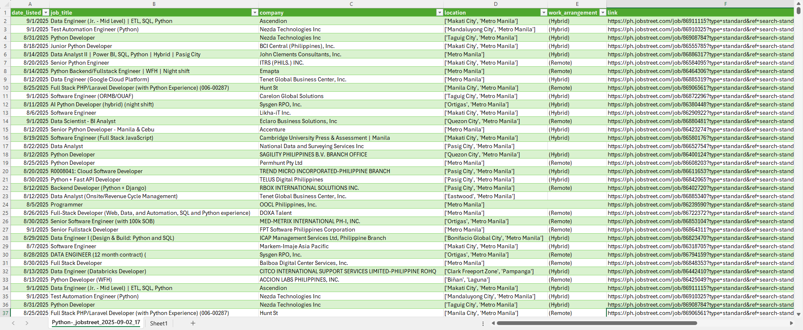

# Job Posting Scraper with RAG Querying 

A Python-based tool that scrapes job postings from Jobstreet (with planned support for Indeed and LinkedIn), structures the results into a clean CSV/Excel dataset, and standardizes fields such as job title, company, location, work arrangement, and job details.

The project also includes a Retrieval-Augmented Generation (RAG) implementation with LangChain, currently under development, to enable natural language queries over job postings (e.g., “Find 5 jobs posted in the past week requiring 0–1 years of Python experience”).

## Sample Output

