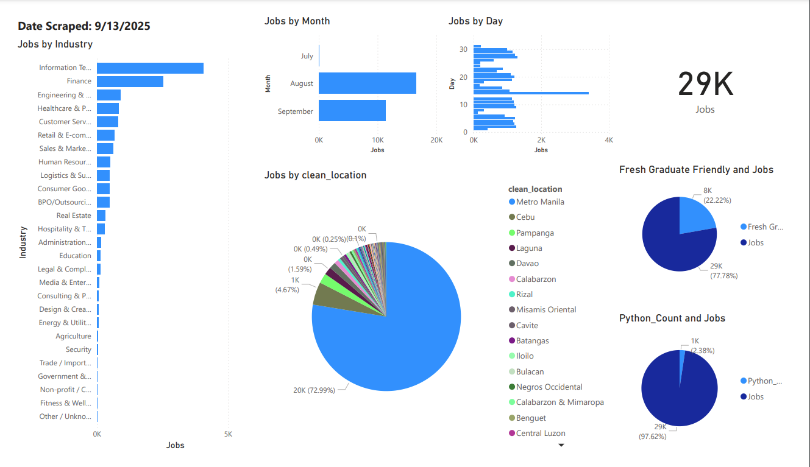

# Job Posting Scraper & Job Market Analytics Dashboard

## Overview
A Python-based project that scrapes job postings from **JobStreet**, structures the results into a clean dataset (CSV), and uses an LLM to standardize fields such as job title, company, location, work arrangement, and job details.

The project extends into **analytics and visualization** with Power BI, where job data is cleaned, modeled, and visualized to uncover hiring trends.  
Additionally, a **Retrieval-Augmented Generation (RAG)** implementation with **LangChain** is under development to enable natural language queries over job postings (e.g., *“Find 5 jobs posted in the past week requiring 0–1 years of Python experience”*).

---

## Features
- **Data Collection**  
  - Scraped job postings with Python.  
  - Exported data into CSV/Excel format.  

- **Data Cleaning & Transformation**  
  - Standardized industries and locations.  
  - Handled nulls, inconsistent text, and column restructuring.  
  - Created conditional columns and DAX measures for accurate reporting.  

- **Dashboard & Insights (Power BI)**  
  - 📊 Jobs by **Industry, Month, Day**  
  - 🌍 Jobs by **Location (cleaned and standardized)**  
  - 🎓 Breakdown of **Fresh Graduate-Friendly Jobs**  
  - 🐍 Demand for **Python-related roles**  
  - Total job counts and posting trends  

- **Natural Language Querying (In Progress)**  
  - RAG pipeline with **LangChain** + LLM API for querying structured job data.  

---

## Output

### Job scraped:

---

## Tools & Technologies
- **Python** (Selenium, BeautifulSoup, Pandas)  
- **LangChain + LLM API** (RAG querying, WIP)  
- **Power BI** (Power Query, DAX, visualizations)  

---

## Dashboard:

## Key Insights
- IT and Finance dominate job postings.  
- **Metro Manila** holds the majority of job opportunities.  
- ~22% of roles are open to **fresh graduates**.  
- Python-related jobs make up a smaller but notable share of postings.  
